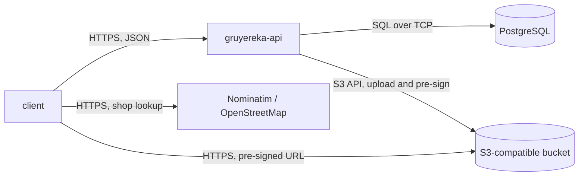

# Architecture

## Overview

Gruyereka is a single Rust HTTP service, `gruyereka-api`, sitting between its
clients and two stores: PostgreSQL for everything relational, and an
S3-compatible bucket for the cheese photos. The service is stateless — every
piece of state lives in one of the two stores — so it scales horizontally and
restarts freely.

The arrow the diagram is really about is the missing one: `gruyereka-api` never
talks to OpenStreetMap. The client resolves a shop before creating it and hands
over the reference — see
[ADR 0002](docs/adr/0002-resolve-shop-identity-against-openstreetmap-in-the-client.md).

## Components

`gruyereka-api` is one binary, layered inside `gruyereka-api/src/`:

- **`api/`** — the HTTP boundary. Owns the wire contract: one dedicated DTO per
  request and per response, `camelCase` JSON, `validator` checks at the edge,
  and the OpenAPI document `aide` derives from the routes. It maps DTOs to
  domain types and back, and it is the only layer that knows about status codes.
- **`domain/`** — the entities and the closed vocabularies (rating levels, milk
  types, paste types, quality schemes, shop kinds). Deliberately not
  serialisable as entities: `Serialize`/`Deserialize` are not derived on
  `Cheese`, `Shop`, `Tasting` or `User`, so binding one straight to the wire
  fails to compile. The value enums *are* serialisable, because a closed
  vocabulary is the contract rather than an internal shape.
- **`repository/`** — one struct per aggregate over a `sqlx` `PgPool`. Owns
  every SQL statement, all of them static strings, and translates PostgreSQL
  integrity errors (`23505`, `23503`) into the three outcomes the boundary can
  act on: conflict, broken reference, not found.
- **`bootstrap.rs`** — runs once at startup, after the migrations, to reconcile
  the administrator account described by the configuration. Declarative rather
  than one-shot: it creates the account if it is missing and reapplies the
  configured password and the admin role if they have drifted, so recovering an
  instance that has lost its last administrator is a restart.
- **`photo.rs`** — the object store. Uploads and pre-signs; knows nothing about
  cheeses beyond the key it is handed.

## Data flow

**Recording a tasting.** The client authenticates, gets a cheese and a shop (or
creates them), then posts a tasting. The handler validates the DTO, maps it to
`NewTasting` with the caller's id as the author, and inserts. A cheese or shop
id that does not exist comes back from PostgreSQL as a foreign-key violation and
is answered `422 UNKNOWN_REFERENCE`, not `500` — the check is the database's,
not a pre-flight `SELECT`, so two concurrent requests cannot race past it.

**Reading a cheese.** `GET /api/v1/cheeses/{cheese_id}` returns the cheese plus
its tasting count and mean score, aggregated over every shop by correlated
subqueries in the same statement. The mean is computed from `rating_score()`, a
SQL function that projects the rating enum onto 1–5, so the ordering of the
scale is defined once, in the schema.

**Serving a photo.** The bucket stays private. `GET /api/v1/cheeses/{cheese_id}/photo`
answers `307` to a pre-signed URL that expires in fifteen minutes, and the
client follows it straight to the bucket. Photo bytes never pass back through
the API, and a leaked URL stops working.

## State and persistence

PostgreSQL holds users, cheeses, shops, tastings and shop reviews. The bucket
holds photo objects keyed `cheeses/<cheese id>`; the row keeps the key, the
bucket keeps the bytes.

Identifiers are UUIDv7 everywhere: they are unguessable like a v4 and sort by
creation time like a sequence, so a listing ordered by id is chronological and
index locality is preserved.

Two identity rules carry most of the design:

- **A cheese is `(normalized name, milk types, paste, aging)`.** The
  normalisation — accent folding, case folding, punctuation collapsed to single
  spaces — happens in `domain::cheese::normalize_name` and is stored alongside
  the name. The unique index sorts and deduplicates the milk array through
  `sorted_milk_types()`, so `{cow, goat}` and `{goat, cow}` collide, and it is
  declared `NULLS NOT DISTINCT`, so two cheeses with no stated aging collide
  too. Aging is part of the identity because a young and an old wheel of the
  same name are not the same product.
- **A shop is its OpenStreetMap reference.** Name and address are cached
  attributes; `(osm_element, osm_id)` is the key.

A **tasting is an append-only log entry**, not a rating that gets overwritten: it
carries the day it happened and the price paid that day, both of which move with
time and shop. Tasting the same cheese at the same place again adds a row.
Correcting a mistake is a `PUT` on that row, scoped to its author. A **shop
review**, by contrast, is unique per author and shop — posting again rewrites
it, because an opinion of a shop is a current position rather than an event.

## Design decisions

**Three roles, and the role is read from the database on every request.** A user
owns their own ratings, a moderator rewrites and deletes anybody's, an
administrator additionally hands out roles. The role is *not* carried in the
access token: tokens are not revocable, so a role baked into one would keep
granting privileges for the token's whole lifetime after a demotion. Resolving it
per request costs one primary-key lookup and buys immediate effect for both
grants and demotions.

Authorization is expressed as an `AuthorScope` handed to the repository rather
than a check in the handler. A write is pinned to its author unless the caller
moderates, and the scope goes into the `WHERE` clause, so a moderator's reach is
one widened predicate instead of a second code path. A plain user aiming at
somebody else's row gets a `404`, not a `403`, because a `403` would confirm the
row exists; `403` is reserved for the administrator-only endpoints, where there
is nothing to hide.

**No language on the wire.** Closed vocabularies are stable `SCREAMING_SNAKE`
codes and clients translate them; error responses carry a `code` plus the
offending field names, never a display string. The alternative — negotiating
`Accept-Language` and returning French labels — would put the vocabulary in the
server and force a deployment for every wording change. User-written content is
never translated, in either direction: a cheese name is a proper noun, and an
appellation is legally untranslatable.

**Money as integer minor units plus an ISO 4217 code.** A price in a float is a
rounding bug with a delay fuse, and the currency has to travel with the amount
because the same shop's prices are not comparable across borders. The two
columns are constrained to be set or null together.

**Argon2 password hashes and HS256 access tokens, issued by the API itself.**
See [ADR 0001](docs/adr/0001-keep-accounts-and-passwords-in-the-api.md).

**Photos in an S3-compatible bucket, not in PostgreSQL and not on a volume.**
See [ADR 0003](docs/adr/0003-store-cheese-photos-in-s3-compatible-object-storage.md).
The API is written against the S3 API alone and never against a particular
implementation, so which server provides it is a deployment choice: the Compose
stack runs SeaweedFS, and anything else speaking S3 works unchanged.

**Static SQL strings only.** `sqlx` 0.9 refuses a runtime-built query string
unless it is explicitly asserted safe; the repositories keep every statement a
literal and push all variation into bind parameters, including the optional
filters, which are written as `$1::text IS NULL OR …`. Composing SQL with
`format!` would work and is one `AssertSqlSafe` away — the point is that nobody
can add an interpolated filter later without deliberately removing the guard.

## Invariants and constraints

- **`normalized_name` is only ever written by `CheeseRepository::create`.** It
  is not a generated column, because accent folding is not an immutable SQL
  expression. Any other write path that sets it independently silently breaks
  the identity index.
- **A tasting's price and its currency are set or null together**, enforced by
  `tastings_price_needs_currency`. The row mapping relies on it.
- **Every write endpoint takes `AuthUser`.** An endpoint that does not extract
  it is public by construction, which is the only place the distinction is
  made — there is no route-level middleware to forget.
- **No registration path can grant a role.** `NewUser` carries no role field and
  the insert never names the column, so the `user` database default applies;
  `UserRepository::set_role` is the only write that touches it. A `role` in a
  registration body is not rejected, it is simply unrepresentable.
- **An administrator cannot change their own role**, so an instance is never
  left without one by a single request. The check is local to the handler rather
  than a count of remaining administrators, which two concurrent requests could
  both pass.
- **A tasting is edited and deleted only by its author**, enforced in the
  `WHERE` clause rather than by a read-then-check, so somebody else's row reads
  as absent instead of forbidden.
- **PostgreSQL 15 or later**, for `NULLS NOT DISTINCT` on the cheese identity
  index. On an older server the migration fails at startup rather than silently
  allowing duplicates.

## Limitations

- **Shop addresses are whatever the client says they are.** The API validates
  their shape, never their truth, because it does not query OpenStreetMap.
- **Nothing merges duplicates.** Two clients that resolve different OSM
  references for the same physical shop create two shops, and a cheese entered
  with the wrong paste is a distinct cheese from the same one entered correctly.
  There is no moderation surface and no merge operation.
- **Access tokens cannot be revoked one by one.** A token stays usable until it
  expires, and changing a password does not cut existing sessions. Deleting the
  account does, and so does a role change, because both are read back from the
  database on every request — but there is no way to invalidate a single token
  while keeping the account.
- **The administrator account's password is owned by the configuration.** It is
  reapplied at every startup, so that account cannot durably change its own
  password through the API.
- **One photo per cheese**, keyed on the cheese id, and a cheese's photo is
  global rather than per shop or per tasting.
- **Listings are offset-paginated**, which is fine at this size and degrades on
  deep pages; there is no cursor pagination.
