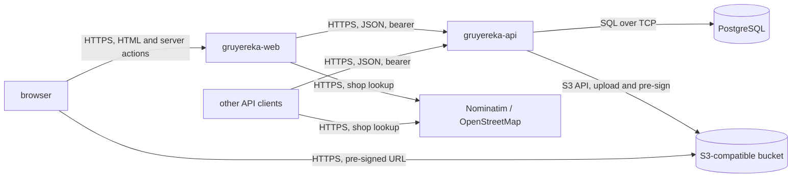

# Architecture

## Overview

Gruyereka is two services. `gruyereka-api` is a Rust HTTP service holding every
piece of domain state in PostgreSQL and the cheese photos in an S3-compatible
bucket. `gruyereka-web` is a Next.js server rendering the browser-facing client
against that API. Both are stateless — all state lives in one of the two stores
— so either scales horizontally and restarts freely.

The arrow the diagram is really about is the missing one: `gruyereka-api` never
talks to OpenStreetMap. Every client resolves a shop for itself before creating
it and hands over the reference — see
[ADR 0002](docs/adr/0002-resolve-shop-identity-against-openstreetmap-in-the-client.md).
And the browser never talks to `gruyereka-api`: it reaches the API only through
`gruyereka-web`, which holds the access token — see
[ADR 0004](docs/adr/0004-render-the-web-client-on-its-own-server.md). The bucket
is the one exception, and only over a pre-signed URL that expires.

## Components

`gruyereka-api` is one binary, layered inside [gruyereka-api/src/](gruyereka-api/src/):

- **`api/`** — the HTTP boundary. Owns the wire contract: one dedicated DTO per
  request and per response, `camelCase` JSON, `validator` checks at the edge,
  and the OpenAPI document `aide` derives from the routes. It maps DTOs to
  domain types and back, and it is the only layer that knows about status codes.
- **`domain/`** — the entities and the closed vocabularies (rating levels, milk
  types, paste types, quality schemes, shop kinds). Deliberately not
  serialisable as entities: `Serialize`/`Deserialize` are not derived on
  `Cheese`, `Shop`, `Tasting` or `User`, so binding one straight to the wire
  fails to compile. The value enums *are* serialisable, because a closed
  vocabulary is the contract rather than an internal shape.
- **`repository/`** — one struct per aggregate over a `sqlx` `PgPool`. Owns
  every SQL statement, all of them static strings, and translates PostgreSQL
  integrity errors (`23505`, `23503`) into the three outcomes the boundary can
  act on: conflict, broken reference, not found.
- **`bootstrap.rs`** — runs once at startup, after the migrations, to reconcile
  the administrator account described by the configuration. Declarative rather
  than one-shot: it creates the account if it is missing and reapplies the
  configured password and the admin role if they have drifted, so recovering an
  instance that has lost its last administrator is a restart.
- **`photo.rs`** — the object store. Uploads and pre-signs; knows nothing about
  cheeses beyond the key it is handed.

`gruyereka-web` is a Next.js application in [gruyereka-web/src/](gruyereka-web/src/),
and the only client that does not hold a token of its own:

- **`app/`** — the routes. Public pages are server components that read the API
  and return finished HTML with their metadata, canonical link and `schema.org`
  payload; writes are server actions. Cheeses and shops are indexable; the
  carnet, the profile, the administration, the forms and the correction pages
  are `noindex` and redirect a signed out visitor to the sign-in.
  `app/photos/[cheeseId]/` relays the API's photo redirect so the browser keeps
  talking to one origin.
- **`lib/api/`** — the wire boundary. One `zod` schema per response, parsed on
  arrival, so a drifting contract fails here rather than three components later;
  `client.ts` is the only module that calls the API, and the only one that turns
  a refusal into an `ApiError` carrying its stable code.
- **`lib/api/nominatim.ts`** — the geocoder, and the only outbound call that
  does not go to `gruyereka-api`. It turns a query into candidate shops, drops
  the hits that cannot become one, and holds the outbound rate to the one
  request per second the usage policy allows.
- **`lib/session.ts`** — the access token, in an httpOnly cookie this server
  sets and reads. Nothing in `components/` can see it.
- **`lib/vocabulary.ts`** — the French wording for every closed vocabulary. The
  API sends codes and this file is the single place one becomes a word.
- **`components/`** — presentation only. No component fetches, and none reads
  configuration.

## Data flow

**Recording a tasting.** The client authenticates, gets a shop and one or more
cheeses (or creates them), then posts a visit: the shop, the day, and a list of
cheeses each carrying its own rating, price and comment. The handler validates
the DTO — a basket is never empty and never names the same cheese twice — and
the repository writes the visit and its items in one transaction, so a single
broken reference rolls the whole visit back rather than leaving half a basket.
A cheese or shop id that does not exist comes back from PostgreSQL as a
foreign-key violation and is answered `422 UNKNOWN_REFERENCE`, not `500` — the
check is the database's, not a pre-flight `SELECT`, so two concurrent requests
cannot race past it.

A correction replaces the whole list of items rather than diffing it, which is
why dropping a cheese from a visit needs no operation of its own. The author
scope is checked on the parent row *before* an item is touched, so a refused
correction cannot empty somebody else's basket on its way out.

**Adding a shop.** The form searches Nominatim through a server action rather
than a route of its own, so the browser never calls the geocoder and this app
never becomes an open proxy for it — the action refuses a caller with no
session for the same reason. What comes back is already shaped like a shop:
name, street, postcode, town, country, coordinates and the
`(osm_element, osm_id)` pair. Picking one fills a hidden field with that whole
object, and the action posts it to `POST /shops`. A second person adding the
same cheesemonger gets a `409`, which is the reference doing its job.

**Reading a cheese.** `GET /api/v1/cheeses/{cheese_id}` returns the cheese plus
its tasting count and mean score, aggregated over the *items* that name it —
never over the visits containing them — by correlated subqueries in the same
statement. The mean is computed from `rating_score()`, a
SQL function that projects the rating enum onto 1–5, so the ordering of the
scale is defined once, in the schema.

**Serving a photo.** The bucket stays private. `GET /api/v1/cheeses/{cheese_id}/photo`
answers `307` to a pre-signed URL that expires in fifteen minutes, and the
client follows it straight to the bucket. Photo bytes never pass back through
the API, and a leaked URL stops working.

**Opening a public fiche.** The browser asks `gruyereka-web` for
`/fromages/{id}`. That server fetches the cheese and its tastings from the API
with no credentials, resolves the shop of each tasting, and returns finished
HTML carrying the title, the description, the canonical link and a `schema.org`
`Product` block. A link unfurler or a crawler reading that response sees the
rating without executing anything. Search and paging are query parameters on
that URL, so a result page is addressable and works with JavaScript off.

**Signing in.** The browser posts the form to a server action on
`gruyereka-web`, which calls `POST /auth/login` and puts the returned token in
an httpOnly, `SameSite=Lax` cookie. Page JavaScript never sees the token; every
later authenticated call is made by the server, which reads the cookie and
attaches the bearer. Signing out deletes the cookie — the token itself stays
valid until it expires, since the API cannot revoke one.

## State and persistence

PostgreSQL holds users, cheeses, shops, tastings, the cheeses of each tasting
and shop reviews. The bucket
holds photo objects keyed `cheeses/<cheese id>`; the row keeps the key, the
bucket keeps the bytes.

Identifiers are UUIDv7 everywhere: they are unguessable like a v4 and sort by
creation time like a sequence, so a listing ordered by id is chronological and
index locality is preserved.

Two identity rules carry most of the design:

- **A cheese is `(normalized name, milk types, paste, aging)`.** The
  normalisation — accent folding, case folding, punctuation collapsed to single
  spaces — happens in `domain::cheese::normalize_name` and is stored alongside
  the name. The unique index sorts and deduplicates the milk array through
  `sorted_milk_types()`, so `{cow, goat}` and `{goat, cow}` collide, and it is
  declared `NULLS NOT DISTINCT`, so two cheeses with no stated aging collide
  too. Aging is part of the identity because a young and an old wheel of the
  same name are not the same product.
- **A shop is its OpenStreetMap reference.** Name and address are cached
  attributes; `(osm_element, osm_id)` is the key.

A **tasting is one visit, and an append-only log entry** rather than a rating
that gets overwritten: it carries the day it happened and, per cheese, the price
paid that day — both of which move with time and shop. Buying the same cheese at
the same place again is another visit, not an edit. Correcting a mistake is a
`PUT` on the visit, scoped to its author.

**The rating and the price hang off the cheese, not off the visit.** A basket
holds several cheeses and one score for all of them would let a good one carry a
mediocre one — and there would be nowhere to put a price per kilogram, which is
the whole point of the log. `(tasting, cheese)` is unique: the same cheese twice
in one visit is one line.

A **shop review**, by contrast, is unique per author and shop — posting again
rewrites it, because an opinion of a shop is a current position rather than an
event.

## Design decisions

**Three roles, and the role is read from the database on every request.** A user
owns their own ratings, a moderator rewrites and deletes anybody's, an
administrator additionally hands out roles. The role is *not* carried in the
access token: tokens are not revocable, so a role baked into one would keep
granting privileges for the token's whole lifetime after a demotion. Resolving it
per request costs one primary-key lookup and buys immediate effect for both
grants and demotions.

Authorization is expressed as an `AuthorScope` handed to the repository rather
than a check in the handler. A write is pinned to its author unless the caller
moderates, and the scope goes into the `WHERE` clause, so a moderator's reach is
one widened predicate instead of a second code path. A plain user aiming at
somebody else's row gets a `404`, not a `403`, because a `403` would confirm the
row exists; `403` is reserved for the administrator-only endpoints, where there
is nothing to hide.

**No language on the wire.** Closed vocabularies are stable `SCREAMING_SNAKE`
codes and clients translate them; error responses carry a `code` plus the
offending field names, never a display string. Each client owns its
bundle: for the web one it is [gruyereka-web/src/lib/vocabulary.ts](gruyereka-web/src/lib/vocabulary.ts),
the single place a code becomes a word, tested to cover every code the API can
send. The alternative — negotiating
`Accept-Language` and returning French labels — would put the vocabulary in the
server and force a deployment for every wording change. User-written content is
never translated, in either direction: a cheese name is a proper noun, and an
appellation is legally untranslatable.

**Money as integer minor units plus an ISO 4217 code.** A price in a float is a
rounding bug with a delay fuse, and the currency has to travel with the amount
because the same shop's prices are not comparable across borders. The two
columns are constrained to be set or null together.

**Argon2 password hashes and HS256 access tokens, issued by the API itself.**
See [ADR 0001](docs/adr/0001-keep-accounts-and-passwords-in-the-api.md).

**Photos in an S3-compatible bucket, not in PostgreSQL and not on a volume.**
See [ADR 0003](docs/adr/0003-store-cheese-photos-in-s3-compatible-object-storage.md).
The API is written against the S3 API alone and never against a particular
implementation, so which server provides it is a deployment choice: the Compose
stack runs SeaweedFS, and anything else speaking S3 works unchanged.

**Static SQL strings only.** `sqlx` 0.9 refuses a runtime-built query string
unless it is explicitly asserted safe; the repositories keep every statement a
literal and push all variation into bind parameters, including the optional
filters, which are written as `$1::text IS NULL OR …`. Composing SQL with
`format!` would work and is one `AssertSqlSafe` away — the point is that nobody
can add an interpolated filter later without deliberately removing the guard.

**The browser talks to `gruyereka-web`, never to `gruyereka-api`.** See
[ADR 0004](docs/adr/0004-render-the-web-client-on-its-own-server.md). It buys
link previews and indexable fiches, a token no page script can read, and a web
client that needs no CORS grant — `CORS_ALLOWED_ORIGINS` exists for the clients
that do call the API directly. It costs a second process to run and a second
declaration of the wire contract.

**The web client parses every response it receives.** `zod` schemas mirror the
API's DTOs and are applied on arrival, so a field that changes type shows up as
a loud failure at the boundary rather than as `undefined` rendered three
components deep. The schemas are hand-written against the OpenAPI document
rather than generated from it, which keeps the build free of a code-generation
step and puts the duplication somewhere a test can see it.

## Invariants and constraints

- **`normalized_name` is only ever written by `CheeseRepository::create`.** It
  is not a generated column, because accent folding is not an immutable SQL
  expression. Any other write path that sets it independently silently breaks
  the identity index.
- **A tasting's price and its currency are set or null together**, enforced by
  `tastings_price_needs_currency`. The row mapping relies on it.
- **Every write endpoint takes `AuthUser`.** An endpoint that does not extract
  it is public by construction, which is the only place the distinction is
  made — there is no route-level middleware to forget.
- **No registration path can grant a role.** `NewUser` carries no role field and
  the insert never names the column, so the `user` database default applies;
  `UserRepository::set_role` is the only write that touches it. A `role` in a
  registration body is not rejected, it is simply unrepresentable.
- **An administrator cannot change their own role**, so an instance is never
  left without one by a single request. The check is local to the handler rather
  than a count of remaining administrators, which two concurrent requests could
  both pass.
- **A tasting is edited and deleted only by its author**, enforced in the
  `WHERE` clause rather than by a read-then-check, so somebody else's row reads
  as absent instead of forbidden.
- **A tasting always holds at least one cheese.** The boundary refuses an empty
  basket and the repository writes a visit and its items in one transaction, but
  nothing in the schema enforces it: a `DELETE` straight against `tasting_items`
  would leave a visit that records nothing.
- **PostgreSQL 15 or later**, for `NULLS NOT DISTINCT` on the cheese identity
  index. On an older server the migration fails at startup rather than silently
  allowing duplicates.

## Limitations

- **Shop addresses are whatever the client says they are.** The API validates
  their shape, never their truth, because it does not query OpenStreetMap.
- **Nothing merges duplicates.** Two clients that resolve different OSM
  references for the same physical shop create two shops, and a cheese entered
  with the wrong paste is a distinct cheese from the same one entered correctly.
  There is no moderation surface and no merge operation.
- **Access tokens cannot be revoked one by one.** A token stays usable until it
  expires, and changing a password does not cut existing sessions. Deleting the
  account does, and so does a role change, because both are read back from the
  database on every request — but there is no way to invalidate a single token
  while keeping the account.
- **The administrator account's password is owned by the configuration.** It is
  reapplied at every startup, so that account cannot durably change its own
  password through the API.
- **One photo per cheese**, keyed on the cheese id, and a cheese's photo is
  global rather than per shop or per tasting.
- **Listings are offset-paginated**, which is fine at this size and degrades on
  deep pages; there is no cursor pagination.
- **The wire contract is declared twice**, once as the API's DTOs and once as
  the web client's schemas. Nothing checks the two against each other: a change
  to one is caught at runtime by the client's parser, not at build time.
- **The geocoder's rate limit is held per process.** The one-request-per-second
  queue in `nominatim.ts` is a module-level variable, so two instances of
  `gruyereka-web` behind a load balancer can send two requests in the same
  second. Holding it across instances needs a shared store, which this does not
  have.
- **A shop review cannot be found past the first page of reviews.** The API
  exposes `PUT` and `DELETE` on `reviews/me` but no `GET`, so the fiche looks
  for the reader's own review in the page it already fetched. Further down the
  list, the form opens blank — submitting it still overwrites, since the API
  keys a review on its author.
- **A moderator has the reach but no button.** The API scopes a write to its
  author unless the caller moderates, so a moderator may rewrite anybody's
  tasting or review — the web client offers the controls only on the reader's
  own rows. Exercising the wider scope means calling the API directly.
- **A tasting shows no author name.** `GET /users` is administrator-only and
  there is no public endpoint for a single account, so a client that is not an
  administrator cannot resolve the `userId` on a tasting or a review into a
  display name. The web client marks its own entries and leaves the others
  unattributed.
